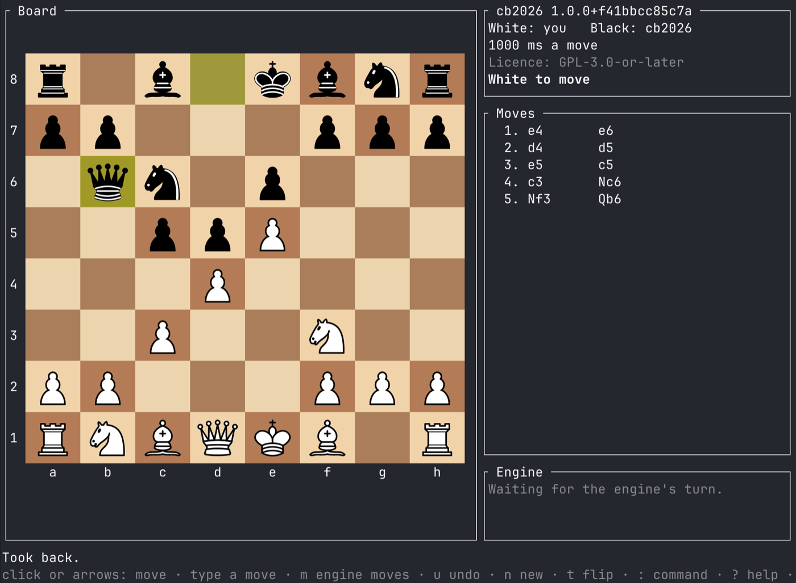

# cbtui

Play chess in your terminal against a real engine, and watch it think.

cbtui is a full-screen terminal chess client built with [Ratatui](https://ratatui.rs). It
doesn't play chess itself. It starts an engine that speaks the
[Chess Node Protocol](https://github.com/cjus/chess-node-protocol) (CNP) and asks it for moves:
[cb2026](https://github.com/cjus/chessengine) by default, or any newer CNP engine. Everything
it shows comes from what the engine says it can do, so a newer engine works without changes
here.



## What it does

- **Play** with the mouse, the arrow keys, or by typing `Nf3`. The engine plays White, Black,
  both sides or neither, at any of its levels, to a fixed time a move or a clock with an
  increment (`5+3`). Take back, resign, offer a draw, or start from any position.
- **Real piece pictures** in terminals that can show images (Ghostty, kitty, iTerm2, WezTerm,
  foot and others), and crisp letters or symbols everywhere else, tmux and SSH included.
- **Analyse** any position with several lines at once, look back through the game, and see
  the engine's evaluation broken down term by term.
- **Look inside the search:** follow it at its root, live, with each root move's share of
  the effort, or walk the tree it searched, move by move. Switch its search techniques
  (null-move pruning, killer moves, ...) off and on and see what changes.
- **Pondering:** the engine thinks on your time on the reply it expects.
- **Five board themes**, a dark one for dark terminals among them.
- **A PGN viewer** that steps through a game and its variations, no engine needed, and plays
  on from any position.
- Settings are remembered between runs. Downloads for macOS, Linux and Windows.

## Download

Each [release](https://github.com/cjus/cbtui/releases) has downloads for macOS (Apple silicon
and Intel), Linux (x86_64 and ARM64) and Windows, with the cb2026 engine in them, so there is
nothing else to install:

```sh
tar xzf cbtui-*.tar.gz
cd cbtui-*/
./cbtui
```

On Windows, unzip it, open the folder in Windows Terminal and run `.\cbtui.exe`. The macOS
programs are signed and notarised by Apple. The release notes say which download is which.

To see what it can do before playing, run `./cbtui --demo`: a short game that plays itself
through the features (zoom and every theme included), then hands it over to you. Any key
takes over sooner.

## Install from source

You need Rust 1.97 or newer, and an engine.

```sh
# The engine: cb2026, which speaks CNP with `cb2026 --cnp`.
cargo install --locked --git https://github.com/cjus/chessengine cb2026

# cb2026's default build includes Syzygy tablebase probing, which makes that binary
# GPL-3.0-or-later; add --no-default-features for an MIT OR Apache-2.0 engine without it.
# cbtui shows whichever licence the engine reports (press ? in cbtui). cbtui itself
# links no GPL code.

# cbtui itself.
cargo install --locked --git https://github.com/cjus/cbtui
```

## Play

```sh
cbtui                       # you play White against cb2026
cbtui --play white          # the engine plays White (also black, both, none)
cbtui --level 8             # a weaker engine, if it has levels
cbtui --movetime 3000       # the engine thinks three seconds a move (default: one)
cbtui --clock 5+3           # five minutes each, three seconds added a move
cbtui --fen "<FEN>"         # start from a position
cbtui --theme blue          # the board: brown (default), blue, green, grey, or dark
cbtui --ponder on           # the engine thinks on your time too, if it can
cbtui --engine ~/bin/cb2027 # another CNP engine (or set CBTUI_ENGINE)
cbtui --demo                # a short game that shows the features by itself
cbtui --help                # every option
```

cbtui plays the engine `--engine` names; else `$CBTUI_ENGINE`; else the one in the settings
file; else a `cb2026` in the same folder as cbtui (as in the downloads); else `cb2026` on the
`PATH`. It starts it with `--cnp`, or with the `--engine-arg` options given.

### Moving

Click a piece and then its square, or use the arrow keys and Enter (or Space), or type a move
(`e4`, `Nf3`, `exd5`, `O-O`, `e8=N`, `e2e4`) and press Enter. A chosen piece shows the
squares it can go to; the last move and a king in check are highlighted. A pawn that reaches
the last rank offers a queen, rook, bishop and knight on the squares beside it: click one, or
press `q`, `r`, `b` or `n` (Enter is a queen, Esc puts the pawn back).

Checkmate, stalemate, threefold repetition, the fifty-move rule, insufficient material and a
fallen flag end the game by themselves.

### Keys

| Key | |
| --- | --- |
| `m` | the engine moves (now, if it is thinking) |
| `u` | take back your last move |
| `n` | new game |
| `[` `]` | look back through the game a move at a time (`Home`, `End`); moves wait until you're back at the end |
| `t` | turn the board around |
| `z` | zoom: the board fills the screen, the status line keeps the last move and the score; again for the panels |
| `i` | analyse: the engine studies the position on the board, several lines at once, until `i` again |
| `v` | the engine's evaluation of the position on the board, term by term |
| `w` | follow the search at its root (again to stop) |
| `:` | type a command (below) |
| `?` | help; when it doesn't fit, ↑ ↓, Page Up, Page Down, Home, End or the mouse wheel scroll it |
| `q` | quit |

### Commands

Press `:`, type the command and press Enter.

| Command | |
| --- | --- |
| `:play white\|black\|both\|none` | which sides the engine plays |
| `:level <n>\|max` | the engine's playing level (alone: the level now) |
| `:time <ms>` | how long the engine thinks a move |
| `:clock <min>+<sec>\|off` | play to a clock (alone: the clock now) |
| `:ponder on\|off` | whether the engine thinks on your time (alone: switch) |
| `:lines <n>` | how many lines an analysis shows |
| `:techniques` | switch the engine's search techniques |
| `:tree [depth]` | walk a search tree of the position on the board |
| `:theme [name]` | the board's colours (alone: the next theme) |
| `:resign`, `:draw` | resign, or offer the engine a draw |
| `:fen <FEN>` | a new game from a position |
| `:pgn <file>` | save the game as PGN |
| `:new` `:undo` `:flip` `:zoom` `:analyse` `:eval` `:root` `:go` `:stop` `:quit` | the same as `n` `u` `t` `z` `i` `v` `w` `m`, `m` while it thinks, `q` |

### Clocks, draws and resigning

With a clock, the clocks start with the first move and stand beside the players' names, the
running one highlighted. A fallen flag loses, unless the other side has too little left to
mate, which is a draw. An engine that can read a clock (the CNP `clock` capability, as cb2026
can) is sent both and decides its own time; one that can't gets a share of its time left each
move.

`:draw` offers the engine a draw, which it answers with its next move: from move 30 on, it
accepts when its own score says it is clearly worse (by half a pawn or more), or that it is
being mated. `u` takes back a resignation or an agreed draw, and a takeback puts the clocks
back to where they were.

### Pondering

With `:ponder on` (and an engine that can, as cb2026 can), the engine keeps thinking while
it's your move, on the reply it expects; the engine panel says which. Play that reply and it
answers sooner and stronger, keeping what it found; play another and it starts afresh.

## Study with the engine

Each of these appears only with an engine that has it; with one that doesn't, cbtui says so.

**Analysis (`i`).** The engine plays neither side and the clocks stop: move for both sides, or
look back with `[` `]`, and the engine panel follows the position on the board with its best
lines (`:lines <n>` for how many, 3 to start with, if the engine can find several). In the
PGN viewer it takes the place of the notes and follows you through the game. `i` again puts
back who played what.

**Evaluation (`v`).** What the engine's evaluation of the position on the board is made of:
material, mobility, king safety, whatever its terms are, each for both sides.

**Search techniques (`:techniques`).** The search techniques the engine can switch, each with
what it does. ↑ ↓ choose one, Space switches it, `d` puts it back to its default, Esc closes.
A switch holds for every search after, the engine's moves and analyses alike: try analysing
with null-move pruning off, or alpha-beta off to see why nobody searches without it.

**The search at its root (`w`).** In place of the move list: the depth, which root move the
engine is searching and the best so far, a bar for each root move's share of the effort, and
the latest thing it went back over (a move that looked better, a score outside its window).
It follows the engine's moves and analyses alike.

**The search tree (`:tree [depth]`).** The engine searches the position on the board and keeps
the search's tree near the root, and cbtui shows it in place of the side panels: the moves the
search looked at, each with its score and what the search decided about it (refuted by a
reply, left out, searched shallower or again), and the board shows the position you're at.
↑ ↓ choose a move, → goes into it, ← back up, Esc closes.

## Themes

`--theme <name>`, or `:theme <name>` while playing (`:theme` alone goes on to the next):

| Theme | |
| --- | --- |
| `brown` | cream and brown, the wooden board (the default) |
| `blue` | white and blue |
| `green` | cream and green, the tournament board |
| `grey` | off-white and slate grey |
| `dark` | dim slate squares and muted white pieces, for dark terminals |

Each theme has 24-bit and 256-colour shades, and keeps letter and symbol pieces readable on
every square, not only pictures.

## Settings

cbtui saves its settings in `~/.cbtuirc` (`%USERPROFILE%\.cbtuirc` on Windows) whenever they
change, by an option or a `:` command, and the next run starts with them: the theme, how
pieces are drawn, zoom and flip, which side the engine plays, its level, time per move and
clock, pondering, and how many lines an analysis shows. It's plain `key = value` lines, to
edit by hand too; `engine = <path>` and `engine-arg = <arg>` lines name the engine. Options on
the command line win over the file, and `$CBTUI_CONFIG` names another file.

## View a PGN game

```sh
cbtui --pgn game.pgn        # the first game in the file; no engine needed
```

The board is read-only and the panels show the game's players, event and result, its moves
with the variations in brackets, and the comments on the move shown.

| Key | |
| --- | --- |
| `←` `→` | a move back or on, along the line you're in (also `[` `]`) |
| `↑` `↓` | the start of the game, the end of the line (also `Home`, `End`) |
| `1`–`9` | into a variation that starts at this move (the bottom panel lists them) |
| `i` | analyse the position shown, following you as you step |
| `:play white\|black\|both\|none` | play on from the position shown: the engine plays the side(s) named, `none` for you to play both |

## Terminal compatibility

cbtui runs in any terminal at least 61×13 characters with a font that has box-drawing
characters, on macOS, Linux and Windows (Windows Terminal; the Windows build is new and less
tried). What changes from terminal to terminal is how the pieces look.

### Pieces as pictures

At start, cbtui asks the terminal whether it can show images and how big its font is in pixels
(through [ratatui-image](https://github.com/ratatui/ratatui-image)). If it can, the pieces are
pictures that fill their squares, the squares are square, and the board grows to fill its
panel. The pictures are Colin M. L. Burnett's pieces, from Wikimedia Commons, under the BSD
licence (`assets/pieces/`).

| Terminal | Image protocol | Pieces |
| --- | --- | --- |
| Ghostty | kitty | pictures |
| kitty (0.28 or later) | kitty | pictures |
| iTerm2 | iTerm2 | pictures |
| WezTerm | iTerm2 | pictures |
| Rio | iTerm2 | pictures |
| foot | Sixel | pictures |
| xterm, started with `-ti 340` | Sixel | pictures |
| mlterm, Black Box (Flatpak), Bobcat | Sixel / iTerm2 | pictures |
| macOS Terminal | none | letters |
| Alacritty, Konsole, Warp, Contour | none that works | letters |
| anything inside tmux | (not asked) | letters |

The list follows ratatui-image's
[compatibility matrix](https://github.com/ratatui/ratatui-image#compatibility-matrix). A
terminal that isn't listed gets pictures if it answers with a protocol, and letters if it
doesn't.

- **tmux:** image protocols only get through tmux with passthrough set up, and asking tmux
  about them can lose your next key press, so cbtui doesn't ask: inside tmux the pieces are
  always letters.
- **SSH:** images are escape sequences, so they normally get through SSH; what counts is the
  terminal you are sitting at.
- **Zooming:** the font size is asked once, at start. If you zoom the font afterwards (⌘+ or
  Ctrl+), restart cbtui to redraw the pictures at the new size.

### Pieces as letters

Everywhere else the pieces are two letters, side then piece: `WK` is White's king, `BP` a black
pawn. They are white or black too, so they read with or without colour. Here is a 76×20
terminal:

```text
┌ Board ────────────────────┐┌ cb2026 1.0.0+f41bbcc ───────────────────────┐
│                           ││White: you   Black: cb2026                   │
│                           ││800 ms a move                                │
│                           ││White to move                                │
│8 BR BN BB BQ BK BB BN BR  ││                                             │
│7 BP BP          BP BP BP  │└─────────────────────────────────────────────┘
│6       BP    BP           │┌ Moves ──────────────────────────────────────┐
│5    WB    BP              ││  1. e4       e6                             │
│4             WP           ││  2. Nf3      d5                             │
│3                WN        ││  3. Bb5+     c6                             │
│2 WP WP WP WP    WP WP WP  │└─────────────────────────────────────────────┘
│1 WR WN WB WQ WK       WR  │┌ Engine ─────────────────────────────────────┐
│   a  b  c  d  e  f  g  h  ││depth 16/27  -0.06  992.3k nodes  1.2M/s     │
│                           ││0.8s                                         │
│                           ││c6 Bd3 Nd7 exd5 cxd5 O-O Ngf6 Re1 Qc7 Nc3 a6 │
│                           ││Bf1 Be7 d4 O-O a3 b5                         │
│                           ││                                             │
└───────────────────────────┘└─────────────────────────────────────────────┘
cb2026 played c6.
click or arrows: move · type a move · m engine moves · u undo · n new · i an
```

`--pieces letters` asks for letters even where pictures would work, and `--pieces symbols` for
chess symbols (`♚`), one character each. `--ascii` is the same as `--pieces letters`.

### Colour

24-bit when the terminal sets `COLORTERM=truecolor` (or `24bit`), and whenever the pieces are
pictures, since every terminal that shows images has 24-bit colour; otherwise the nearest of
the 256 standard colours, which every modern terminal has, macOS Terminal included.

## How it works

cbtui runs the engine as a child process and talks to it in CNP: JSON-RPC 2.0, one message
per line on the engine's stdin and stdout. Chess rules (legal moves, SAN, PGN, game endings)
come from `cb2026-chess`, cb2026's rules library, which cbtui links. Only `src/rules.rs` uses
it, so another rules library could take its place. See `docs/PRD.md` for the design.

## License

Licensed under either of [Apache License, Version 2.0](LICENSE-APACHE) or
[MIT license](LICENSE-MIT), at your option.
